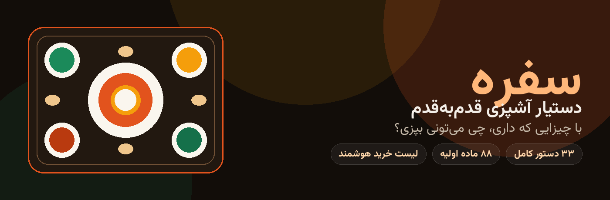

<div align="center">

# 🍽️ سفره | Sofreh



**دستیار آشپزی فارسی: با چیزایی که تو خونه داری، چی می‌تونی بپزی؟**
*Sofreh is a Persian-first cooking assistant (PWA) — tell it what's in your fridge and it tells you what you can cook right now, walks you through it step by step with timers, and builds your shopping list from what's missing.*

[](https://nextjs.org)
[](https://www.typescriptlang.org)
[](https://orm.drizzle.team)
[](https://tailwindcss.com)

</div>

## ✨ قابلیت‌ها | Features

- 🧊 **یخچال هوشمند (Pantry)** — موادت رو ثبت کن؛ برای هر غذا دقیق می‌گه چند درصدش رو داری، چی کم داری و کسری‌ها حدوداً چقدر می‌شن (قیمت‌های تومانی واقعی).
- 🎯 **موتور تطبیق** — غذاها بر اساس تطابق با یخچالت مرتب می‌شن؛ مقدار مواد با تعداد نفرات خودکار تنظیم می‌شه و مواد «زودتر مصرف شود» اولویت می‌گیرن.
- 👨‍🍳 **حالت پخت قدم‌به‌قدم** — صفحه تمام‌صفحه با تایمر جدا برای هر مرحله، حلقه پیشرفت، هشدار صوتی/لرزش، روشن موندن صفحه (Wake Lock) و سشن قابل ادامه.
- 📅 **برنامه‌ریز مهمانی** — تعداد مهمون، زمان و بودجه رو بده؛ منوی کامل (غذای اصلی + مخلفات) با لیست خرید و هزینه تقریبی پیشنهاد می‌ده.
- 🛒 **لیست خرید هوشمند** — از کسری‌های هر غذا یا کل منو ساخته می‌شه؛ اقلام خریدشده با یه دکمه برمی‌گردن به یخچال.
- 🆘 **مرکز نجات آشپزی** — راه‌حل فوری برای «غذا شور شده»، «برنج شفته شده»، «پیازم سوخت»… به‌همراه جدول جایگزین مواد.
- 📚 **۳۳ دستور کامل فارسی** و **۸۸ ماده اولیه** — همه با مراحل دقیق، تایمر و نکته‌های حرفه‌ای (لوبیاپلو تا قورمه‌سبزی).
- 📱 **PWA موبایل‌محور** — کاملاً فارسی و راست‌چین با فونت وزیرمتن، قابل نصب روی گوشی، بدون نیاز به ثبت‌نام (شناسه ناشناس روی دستگاه).

## 🛠️ Tech Stack

| لایه | فناوری |
|---|---|
| Framework | Next.js 16 (App Router) · React 19 · TypeScript |
| Styling | Tailwind CSS 4 · Vazirmatn · design tokens + CSS motion system |
| Database | PostgreSQL · Drizzle ORM (migrations in `drizzle/`) |
| Architecture | API-first — تمام منطق در `src/app/api/*`؛ UI فقط مصرف‌کننده API است |

## 🚀 اجرا | Quick Start

پیش‌نیاز: Node.js 20+ و یک PostgreSQL در دسترس.

```bash
git clone https://github.com/papagit-ss/Sofreh.git
cd Sofreh
npm install
cp .env.example .env        # DATABASE_URL را تنظیم کن
npx drizzle-kit migrate     # ساخت جدول‌ها (یا: npx drizzle-kit push)
npm run dev                 # http://localhost:3000
```

دیتای کاتالوگ (۳۳ دستور و ۸۸ ماده) در اولین درخواست، اگر جدول دستورها خالی باشد، **به‌صورت خودکار seed** می‌شود.

اسکریپت‌ها: `npm run dev` · `npm run build` · `npm run start` · `npm run lint` · `npm run typecheck`

## 🗂️ ساختار پروژه

```
src/
├─ app/            # صفحات (خانه، غذاها، یخچال، برنامه، خرید، ذخیره‌ها، کمک)
│  ├─ api/         # ۱۲ endpoint — کل منطق کسب‌وکار
│  └─ cook/[slug]/ # حالت پخت قدم‌به‌قدم
├─ components/     # UI kit (دکمه، شیت، کارت غذا، ناوبری شناور…)
├─ db/             # اسکیمای Drizzle و seed کاتالوگ
├─ lib/            # api-client، تایپ‌ها، موتور تطبیق (server/catalog.ts)
└─ data/           # داده استاتیک مرکز نجات و جایگزین‌ها
docs/ANDROID.md    # مسیر تبدیل به اپ اندروید (TWA / Capacitor / نیتیو)
```

## 🗺️ نقشه راه | Roadmap

- [ ] اتصال واقعی فروشگاه‌ها (دیجی‌کالا جت، اسنپ‌مارکت، اکالا) — اسکلت `StoreAdapter` آماده است
- [ ] ورود با OTP / گوگل به‌جای شناسه ناشناس
- [ ] اپ اندروید (TWA) — معماری از روز اول برایش آماده شده

## 📱 اندروید (نسخه آزمایشی) | Android (test build)

- **اجرای سرور با Docker:** `docker compose up --build` → اپ روی پورت ۳۰۰۰ بالا می‌آید.
- **پوسته نیتیو سبک** در `android-shell/` — یک WebView تمام‌صفحه که در اولین اجرا آدرس سرور را می‌گیرد (مثلاً آی‌پی کامپیوتر در وای‌فای خانه) و به آن وصل می‌شود. ساخت APK بدون Gradle: `bash android-shell/build-apk.sh` (خروجی دیباگ ساین‌شده، آماده نصب برای تست).
- **پوسته Capacitor** هم آماده است (`capacitor.config.ts` و پوشه `android/`) — مسیر اصلی انتشار آینده طبق `docs/ANDROID.md`.

## 📄 License

MIT — ساخته‌شده با ❤️ زیر برند **PARASIS**
